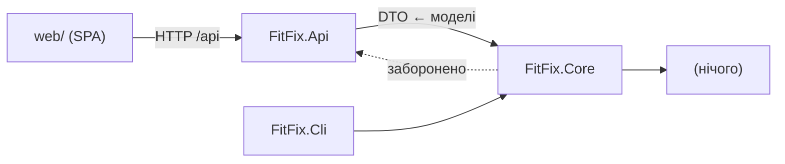
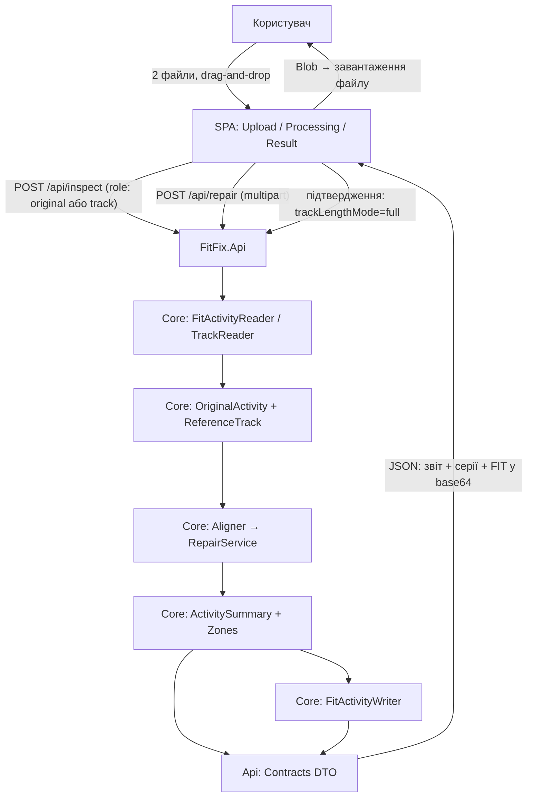
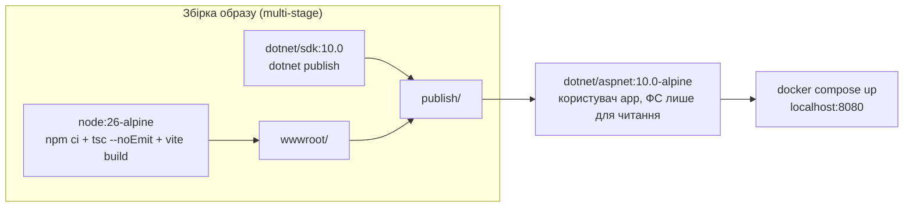

# Architecture Spine — FitFix

## Design Paradigm

**Functional core / imperative shell.** Виправлення активності — детермінована функція: однакові входи дають однаковий вихід, без схованого стану, без мережі, без часу як неявного входу. Усе, що залежить від середовища (HTTP, аргументи, логи, конфігурація), живе в оболонці.

| Шар | Проєкт / тека | Роль |
| --- | --- | --- |
| Ядро (core) | `src/FitFix.Core` | Геометрія, Вирівнювання, Відновлення, Підсумки. Без стану між викликами. |
| Межа ядра (edge) | `src/FitFix.Core/Fit`, `src/FitFix.Core/Tracks` | Парсери форматів і записувач FIT. Мапять зовнішні формати в моделі ядра. Відкривають файл лише через явний виклик `*File(path)`; жодного пошуку, кешу чи тимчасових файлів. |
| Оболонка HTTP | `src/FitFix.Api` | Ендпоінти, DTO контракту, ліміти, `ProblemDetails`, статика, логи. |
| Оболонка CLI | `src/FitFix.Cli` | `fitfix repair` (FR-12). |
| Клієнт | `web/` | SPA: три стани сторінки, карта, графіки, i18n, проріджування для рендеру. |

Порти й DI на все свідомо не вводяться: один сценарій використання, один розробник. Розширюваність дає не інтерфейс, а те, що ядро приймає **модель**, а не байти (AD-2).

## Invariants & Rules



### AD-1 — Ядро не знає про оболонку `[ADOPTED]`

- **Binds:** `FitFix.Core`, усі епіки
- **Prevents:** веб-типи просочуються в алгоритм; CLI і тести стають неможливими без HTTP-контексту
- **Rule:** `FitFix.Core` не посилається на ASP.NET Core і не згадує `HttpContext`, `IFormFile`, конфіг чи логер оболонки. Напрямок залежностей: `Api → Core`, `Cli → Core`, `Core →` нічого. Робота з файлом дозволена лише як `*File(path)`-хелпер над `Stream`-перевантаженням; ядро не читає змінні середовища, не пише тимчасових файлів і не логує.

### AD-2 — Будь-яке джерело даних стає моделлю ядра

- **Binds:** FR-1, FR-2, майбутній епік Strava
- **Prevents:** другий спосіб зібрати активність (наприклад зі Strava Streams) з'являється в оболонці й розходиться з файловим
- **Rule:** кожне джерело мапиться в `OriginalActivity` або `ReferenceTrack` **усередині** `FitFix.Core`. `RepairService` приймає лише ці моделі й ніколи не приймає байти, потоки чи DTO оболонки.

### AD-3 — Stateless без винятків

- **Binds:** FR-1, FR-2, FR-11, пакування
- **Prevents:** тимчасове сховище між `/api/inspect` і `/api/repair` — найочевидніша «оптимізація», яка тихо ламає обіцянку не зберігати файли
- **Rule:** сервер не пише завантажені файли на диск і не тримає їх між запитами. Кожен запит самодостатній; клієнт надсилає ті самі файли повторно. Жодних сесій, серверного кешу результатів, черг. Контейнер працює з файловою системою лише для читання.

### AD-4 — Контракт віддає коди, а не тексти

- **Binds:** FR-10, усі помилки API
- **Prevents:** українські рядки живуть у двох місцях, англійська версія стає неможливою
- **Rule:** API повертає стабільні коди `SCREAMING_SNAKE` і, за потреби, числові параметри. Людські рядки існують лише у `web/src/i18n/uk.ts`; ключ словника дорівнює коду один-до-одного. `ProblemDetails.detail` ніколи не містить тексту винятку.

### AD-5 — Серії прев'ю індексуються записом Оригіналу

- **Binds:** FR-7, FR-8, FR-9
- **Prevents:** сервер прорідує одну серію й не прорідує іншу, і наведення курсора на графік показує на карті не ту точку
- **Rule:** усі серії у відповіді мають однакову довжину `N` = кількість record-записів Оригіналу. Індекс `i` завжди означає `i`-й запис. Відсутні значення — `null`, а не пропущений елемент. Сервер **не** прорідує.

### AD-6 — У контракті одиниці SI, форматування лише в UI

- **Binds:** API, `web/`
- **Prevents:** кілометри в одному полі й метри в іншому; темп у вигляді рядка, який неможливо порахувати
- **Rule:** метри, секунди, метри на секунду, градуси Цельсія, час — UTC ISO-8601. Темп `хв:сек/км`, `год:хв:сек` і локальний час з'являються лише у відрендереному UI.

### AD-7 — Паузи — це інтервали

- **Binds:** FR-5, FR-6
- **Prevents:** дві конкурентні моделі пауз (інтервали проти прапорця на записі), які дають різну дистанцію
- **Rule:** `OriginalActivity` несе `Pauses` — список `(Start, End)`, прочитаний з `event`-повідомлень FIT `timer stop`/`timer start`. Вирівнювання не нараховує дистанцію в межах інтервалу. Ознака «рухався» — похідна від інтервалів і ніколи не зберігається окремо.

### AD-8 — Монотонність дистанції — інваріант, а не наслідок

- **Binds:** FR-5, FR-6, SM-1
- **Prevents:** нова евристика чи згладжування дають локальне спадання дистанції, і Strava рахує відрізки з від'ємним темпом
- **Rule:** функція «час → дистанція» монотонно неспадна на всій активності й закінчується точно на обраній довжині треку (AD-17) — `UsedTrackLength` або повній, залежно від підтвердження користувача. Кожна зміна алгоритму проходить тест монотонності; порушення — дефект, а не компроміс точності.

### AD-9 — У логах немає геоданих

- **Binds:** усі компоненти
- **Prevents:** GPS-сліди користувачів потрапляють у логи, звідки їх ніхто не чистить
- **Rule:** ніколи не логувати координати, вміст файлів та імена завантажених файлів. Дозволено: тривалість обробки, розмір входу, кількість записів і точок, вид спорту, коди попереджень.

### AD-10 — Пороги алгоритму — дані, а не константи в коді

- **Binds:** FR-4, FR-5, FR-12, SM-C1
- **Prevents:** магічні числа розповзаються по методах; CLI і API беруть різні значення й дають різну дистанцію на тих самих файлах
- **Rule:** **кожен** числовий поріг, що впливає на результат, живе в `AlignmentOptions` — включно з мінімальною відстанню дедуплікації треку, вікном перевірки дистанції пристрою, вікном оцінки швидкості й мінімальною кількістю Якорів. Параметрів за замовчуванням у публічних підписах ядра немає: виклик передає `AlignmentOptions` явно. Залежні від виду спорту пороги — у `AlignmentOptions.ForSport`. Жорстких порогів за абсолютним часом активності не існує. Розширення порогу Якоря задля «кращих цифр» заборонено прямо (SM-C1).

### AD-11 — Обробка синхронна в межах запиту

- **Binds:** SM-3, `FitFix.Api`
- **Prevents:** черга, воркер або фонова задача, що неминуче тягнуть за собою стан і ламають AD-3
- **Rule:** `/api/repair` обробляє запит синхронно в межах бюджету SM-3 (3 с на двогодинну активність). Якщо бюджет перестане виконуватись, це новий AD з явним рішенням, а не тихо доданий воркер.

### AD-12 — Один образ, один origin

- **Binds:** пакування, `web/`, `FitFix.Api`
- **Prevents:** два деплої, конфігурація CORS, розбіжність шляхів між dev і prod
- **Rule:** `FitFix.Api` роздає зібрану статику SPA і `/api/*` з одного origin; невідомі шляхи віддають `index.html`. У dev Vite проксує `/api` на бекенд. CORS не налаштовується.

### AD-13 — Межі входу перевіряє оболонка, формат визначає ядро

- **Binds:** FR-1, FR-2, FR-3
- **Prevents:** перевірка розміру розмазується між оболонкою і ядром; або, навпаки, оболонка відкидає валідний GPX через `Content-Type: application/octet-stream`
- **Rule:** оболонка перевіряє **лише розмір** (`FITFIX_MAX_UPLOAD_BYTES`, типово 20 МБ) і кількість частин запиту. `Content-Type` і розширення файлу не впливають на рішення нічого не приймати — формат визначає ядро за вмістом. Семантику перевіряє ядро й кидає доменні винятки з кодом (AD-18).

### AD-14 — Контракт API пишеться руками

- **Binds:** FR-7…FR-11, `FitFix.Api`, `web/`
- **Prevents:** два виконавці серіалізують по-різному: один віддає доменний `RepairReport` як є (протягуючи в контракт похідний темп і порушуючи AD-6), інший пише DTO у формі карток UI — і `report.metrics` на клієнті виявляється `undefined`
- **Rule:** усі тіла відповідей — рукописні `record`-DTO в `FitFix.Api/Contracts`. Доменні типи ядра не серіалізуються **ніколи**. Похідних значень (темп, частки, дельти) у контракті немає — їх рахує UI з базових величин. Енуми передаються рядками, не числами. DTO має один контрактний тест на форму.

### AD-15 — `/api/inspect` знає роль файлу

- **Binds:** FR-1, FR-2, EXPERIENCE.md (Dropzone)
- **Prevents:** FIT валідний і як Оригінал, і як трек; без ролі сервер вгадує, а дві стори Dropzone очікують різні поля під одним шляхом
- **Rule:** `/api/inspect` приймає обов'язковий `role` (`original` | `track`) і повертає дискриміновану відповідь з полем `role`. Усі числа в ній рахуються через **ті самі** моделі ядра, що й у `/api/repair` (трек — через `ReferenceTrack` з тією ж дедуплікацією), щоб Dropzone і hero-картка не показували різну дистанцію.

### AD-16 — Агрегати активності мають одного власника

- **Binds:** FR-6, FR-7, SM-2
- **Prevents:** записувач FIT рахує середній пульс одним способом, епік прев'ю — іншим; користувач бачить у FitFix 154, у Strava 152, і довіра до прев'ю зникає
- **Rule:** усі підсумки (дистанція, час, середні й максимуми пульсу, потужності, каденсу, швидкості, набір висоти, `total_timer_time`, кола) рахує **ядро** в `ActivitySummary`. `FitActivityWriter` і DTO лише транскрибують готові значення й не містять жодної арифметики. Тест порівнює значення в `session`-повідомленні записаного файлу зі звітом.

### AD-17 — Використана довжина треку

- **Binds:** FR-3, FR-5, FR-6, PRD Non-Goals
- **Prevents:** трек із намальованим зайвим колом дає 7,7 км замість 6,5 і темп 4:40 — тобто FitFix «покращує» результат, чого PRD прямо обіцяв не робити. Але й автоматичне обрізання вгадувало б за користувача: трек може бути правильним, а GPS Оригіналу — поганим із самого початку. Без явного власника рішення дві стори отримають взаємовиключні тести
- **Rule:** ядро завжди рахує **дві** величини: повну довжину треку і `UsedTrackLength` — частину, узгоджену з часом Оригіналу і правдоподібною швидкістю за видом спорту. Яку з них брати, вирішує **користувач**, не евристика:
    - Якщо вони розходяться більш ніж на поріг з `AlignmentOptions`, Звіт містить попередження `TRACK_LONGER_THAN_ACTIVITY` рівня `blocking` з обома числами.
    - Типова поведінка до відповіді користувача — `UsedTrackLength` (обрізаний, консервативний варіант), щоб прев'ю ніколи не показувало завищений темп першим.
    - Користувач може підтвердити, що трек правильний; тоді клієнт повторює `/api/repair` з `trackLengthMode=full` і дістає результат на повну довжину. Запит повторюється з тими самими файлами — сервер нічого не пам'ятає (AD-3).
    - Брати повну довжину треку **без** цієї перевірки або без явного підтвердження заборонено.

### AD-18 — Один реєстр кодів, код несе виняток

- **Binds:** FR-10, AD-4, AD-13
- **Prevents:** оболонці нічим заповнити `ProblemDetails.code`, бо винятки ядра несуть лише українські рядки; три незалежні списки кодів розходяться
- **Rule:** коди попереджень і помилок оголошені **одним** місцем у `FitFix.Core` разом із рівнем (`blocking` | `info`). Кожен доменний виняток ядра успадковує `FitFixException` і несе `Code`; `ArgumentException` для вхідних даних користувача заборонено. Тест перевіряє, що множина кодів ядра дорівнює множині ключів `i18n/uk.ts`.

### AD-19 — Структура записаного FIT — інваріант

- **Binds:** FR-6, FR-11, SM-2
- **Prevents:** файл, що імпортується в Strava сьогодні й перестає імпортуватися після рефакторингу, бо порядок повідомлень чи підсумки змінились непомітно
- **Rule:** записаний FIT завжди має порядок `file_id → event(timer start) → record × N → event(timer stop_all) → lap × M → session → activity`. `total_elapsed_time` дорівнює часу Оригіналу (±1 с), `total_timer_time` враховує паузи (AD-7), `total_distance` дорівнює `UsedTrackLength` (±0,5 %). `activity.local_timestamp` обчислюється зі зсуву, прочитаного з `ActivityMesg` Оригіналу; CLI і API передають його однаково. Тест перевіряє і порядок повідомлень, і підсумки.

### AD-20 — Зони — явні інтервали з одного джерела

- **Binds:** FR-9, FR-10
- **Prevents:** межа Надійної зони з'являється у трьох місцях, а модель «зона = префікс до першого збою» ламається, коли GPS відновлюється після провалу
- **Rule:** Звіт несе `Zones` — список інтервалів `(Start, End, Kind)`, де `Kind` — `measured` або `estimated`. Це єдине джерело для смуги на графіку, для позначки на карті й для тексту попереджень. Припущення, що виміряна зона завжди один префікс активності, заборонене.

### AD-21 — Згладжування не перетинає межі пауз і Якорів

- **Binds:** FR-5, AD-7
- **Prevents:** ковзне середнє розмазує рух углиб паузи — дистанція під час пауз формально не зростає, але темп перед і після паузи стає фальшивим
- **Rule:** вікно згладжування обрізається межами пауз і не перетинає їх. Монотонність (AD-8) перевіряється **після** згладжування, а не замість нього.

### AD-22 — Усі помилки виходять однаково

- **Binds:** FR-1, FR-2, FR-10, `FitFix.Api`
- **Prevents:** 413 від Kestrel повертає порожнє тіло, а UI не має коду для свого словника; попередження без рівня змушують UJ-2 проходити через гейт підтвердження, придуманий для UJ-1
- **Rule:** кожна відповідь про помилку — `ProblemDetails` (RFC 9457) з полем `code` з реєстру AD-18, включно з перевищенням розміру (`FILE_TOO_LARGE`, 413) і несподіваною помилкою (`INTERNAL_ERROR`, 500). Проблеми вхідних даних — 400. Завантаження виправленого файлу блокується лише попередженнями рівня `blocking` і лише до явного підтвердження користувача; `info` нічого не блокує. Підтвердження `TRACK_LONGER_THAN_ACTIVITY` не просто знімає гейт, а змінює результат — клієнт повторює запит із `trackLengthMode=full` (AD-17).

### AD-23 — Проріджування лише в UI, індекс один

- **Binds:** FR-8, FR-9, AD-5, SM-3
- **Prevents:** клієнт прорідує для карти й для графіка по-різному, hover переходить у другий простір індексів і показує не ту точку
- **Rule:** проріджування відбувається лише в `web/` і лише для рендеру. Проріджена точка зберігає **оригінальний** індекс запису; hover завжди працює в просторі індексів Оригіналу. Відповідь `/api/repair` стискається (gzip/brotli); якщо нестиснене тіло перевищує бюджет з `FITFIX_MAX_RESPONSE_BYTES`, це помилка конфігурації, а не підстава прорідити на сервері (AD-5).

### AD-24 — Кола Оригіналу — частина моделі

- **Binds:** FR-6
- **Prevents:** «кола перерахує записувач», який структурно не має даних про кола Оригіналу, бо їх ніхто не прочитав
- **Rule:** `OriginalActivity` несе `Laps` — інтервали з `lap`-повідомлень Оригіналу. Ядро перераховує їхні дистанції за Вирівнюванням і віддає в `ActivitySummary` (AD-16); записувач транскрибує. Це вимога MVP, а не відкладена робота.

## Consistency Conventions

| Concern | Convention |
| --- | --- |
| Іменування (C#) | Типи й члени — PascalCase, англійською. XML-доки й коментарі — українською, з посиланням на FR/SM. Один тип — один файл. DTO контракту — суфікс `Response` / `Request`. |
| Іменування (TS) | Компоненти — PascalCase, решта — camelCase. Хуки — `useЩось.ts`. |
| Коди й ключі | `SCREAMING_SNAKE`, оголошені одним місцем у `FitFix.Core` разом із рівнем (AD-18); ключі `i18n/uk.ts` дорівнюють кодам, рівність перевіряє тест. |
| Дані й формати | JSON — camelCase. Енуми — рядками. Одиниці — SI (AD-6). Час — UTC ISO-8601. Серії — паралельні масиви `number[]` з `null` у прогалинах (AD-5). Помилки — `ProblemDetails` з полем `code` (AD-22). |
| Стан | Ядро без стану. `FitFix.Api` без стану між запитами (AD-3). Фронтенд тримає стан сторінки в одному хуку; без роутера й без глобального стору. |
| Конфігурація | Лише змінні середовища з префіксом `FITFIX_` (+ стандартні `ASPNETCORE_*`). Секретів немає, бо немає зовнішніх сервісів. |
| Логи | `Microsoft.Extensions.Logging` із JSON-форматером консолі, без сторонніх бібліотек. Рівень — `FITFIX_LOG_LEVEL`. Без геоданих (AD-9). |
| Тести | Ядро — xunit, синтетичні фікстури генеруються кодом. Реальні файли лише з `tests/fixtures/private/`, тест тихо виходить без них. API — інтеграційні через `WebApplicationFactory`. Обов'язкові контрактні тести: форма DTO (AD-14), рівність реєстру кодів і словника (AD-18), порядок повідомлень і підсумки FIT (AD-19), збіг `session`-значень зі звітом (AD-16). |
| CI | GitHub Actions на кожен push: `dotnet test`, `npm ci`, `tsc --noEmit`, `npm run build`. Vite типи не перевіряє, тому крок `tsc --noEmit` обов'язковий. |

## Stack

| Name | Version |
| --- | --- |
| .NET SDK (LTS) | 10.0.404 |
| ASP.NET Core | 10.0 |
| Garmin.FIT.Sdk | 21.222.0 |
| xunit | 2.9.3 |
| xunit.runner.visualstudio | 4.0.1 |
| Microsoft.NET.Test.Sdk | 18.12.0 |
| coverlet.collector | 10.1.1 |
| Node.js (лише збірка) | 26 LTS |
| React / react-dom / react-is | 19.3.1 |
| @types/react / @types/react-dom | 19.3.0 |
| @types/node | 26.6.6 |
| Vite | 8.3.8 |
| @vitejs/plugin-react | 6.3.0 |
| TypeScript | 7.0.2 |
| tailwindcss / @tailwindcss/vite | 4.3.5 |
| react-leaflet | 5.0.0 |
| leaflet | 1.9.4 |
| recharts | 3.11.0 |
| lucide-react | 1.76.0 |
| @fontsource/unbounded / @fontsource/manrope | 5.3.0 |
| Тайли карти | CARTO dark_all (безкоштовний тир, з атрибуцією) |
| Базові образи | `node:26-alpine`, `mcr.microsoft.com/dotnet/sdk:10.0`, `mcr.microsoft.com/dotnet/aspnet:10.0-alpine` |

Версії звірені з реєстрами npm, NuGet і каналом релізів .NET 19.11.2026. `global.json` має `rollForward: latestFeature`, тож рядок «.NET SDK» тут — перевірений мінімум, а не жорсткий пін.

## Structural Seed

### Контейнери й потік даних



### Поверхня API

| Метод і шлях | Вхід | Вихід |
| --- | --- | --- |
| `POST /api/inspect` | один файл + обов'язковий `role` | дискримінована відповідь: для `original` — вид спорту, початок, тривалість, записана дистанція, кількість записів, чи є GPS; для `track` — довжина, кількість точок, чи є висота |
| `POST /api/repair` | `original` + `track` (multipart) + необов'язковий `trackLengthMode` (`used` типово, `full` після підтвердження) | звіт, `ActivitySummary` до і після, `Zones`, серії прев'ю, FIT у base64, попередження з кодами й рівнями |
| `GET /health` | — | ознака життя для healthcheck |

### Пакування й середовища



Середовищ два: **dev** (Vite проксує `/api` на `dotnet run`) і **local-docker** (один образ, `docker compose up`, `localhost:8080`). Образ тегується `fitfix:local`; реєстру образів у MVP немає, CI образ не публікує. Контейнер працює від непривілейованого користувача `app`, файлова система змонтована лише для читання (можливо завдяки AD-3), healthcheck — `GET /health`.

Змінні середовища — повний інвентар:

| Змінна | Типово | Призначення |
| --- | --- | --- |
| `FITFIX_MAX_UPLOAD_BYTES` | `20971520` | ліміт на один файл (AD-13) |
| `FITFIX_MAX_RESPONSE_BYTES` | `33554432` | бюджет нестиснутої відповіді (AD-23) |
| `FITFIX_LOG_LEVEL` | `Information` | рівень логів (AD-9) |
| `ASPNETCORE_HTTP_PORTS` | `8080` | порт у контейнері |

### Дерево джерел

```text
fitfix/
  src/
    FitFix.Core/        # ядро: Geo, ReferenceTrack, Aligner, GpsStallDetector,
                        #       RepairService, ActivitySummary, FitFixException + реєстр кодів
      Fit/              # читання й запис FIT (Garmin.FIT.Sdk)
      Tracks/           # GPX, TCX, визначення формату за вмістом
    FitFix.Api/
      Contracts/        # рукописні DTO (AD-14)
    FitFix.Cli/         # fitfix repair
  web/
    src/
      components/       # Dropzone, MetricCard, Map, Chart, ZoneBar, Warnings
      hooks/            # useRepair — увесь стан сторінки
      i18n/uk.ts        # усі людські рядки, ключі = коди
  tests/
    FitFix.Core.Tests/
    FitFix.Api.Tests/   # інтеграційні + контрактні
    fixtures/private/   # реальні файли, не в репозиторії
  .github/workflows/    # CI: dotnet test + tsc --noEmit + vite build
```

## Capability → Architecture Map

| Capability / Area | Lives in | Governed by |
| --- | --- | --- |
| FR-1, FR-2 Прийом файлів | `FitFix.Api` + `Core/Fit`, `Core/Tracks` | AD-2, AD-13, AD-15 |
| FR-3 Перевірка сумісності | `Core/Aligner` | AD-17, AD-18 |
| FR-4, FR-5 Якорі та інтерполяція | `Core/Aligner`, `Core/RepairService` | AD-7, AD-8, AD-10, AD-21 |
| FR-6 Генерація FIT | `Core/Fit/FitActivityWriter` | AD-16, AD-19, AD-24 |
| FR-7…FR-10 Прев'ю і попередження | `web/` + `Core/ActivitySummary` | AD-4, AD-5, AD-6, AD-14, AD-20, AD-22, AD-23 |
| FR-11 Видача файлу | `FitFix.Api` → `web/` | AD-3, AD-22 |
| FR-12 CLI | `FitFix.Cli` | AD-1, AD-10, AD-19 |
| Пакування й CI | `Dockerfile`, `compose.yaml`, `.github/workflows` | AD-12 |

## Open Questions

| Питання | Стан |
| --- | --- |
| **OQ-1.** Трек довший за реальний рух | **Вирішено** → AD-17: попереджаємо користувача й даємо вибір. Типово беремо обрізану довжину, за підтвердженням — повну. Рішення належить користувачу, не евристиці. |
| **OQ-2.** Чи потрібен режим «довіряти часу з треку», якщо трек має правильні мітки з іншого пристрою | Відкрите. Не блокує MVP: такий режим був би іншим сценарієм, не іншою архітектурою. Повернутись, коли з'явиться другий реальний кейс. |
| **OQ-3.** Чи зберігати `file_id` Оригіналу (виробник і модель годинника) — Strava показує їх як пристрій | Відкрите, **блокує FR-6 на рівні сторі**. Зараз записувач зашиває `Manufacturer.Development`, тож Strava покаже активність без пристрою. Рішення потрібне до сторі записувача. |
| Чи порушення AD-10 у наявному коді виправляємо окремою сторі | Відкрите. Факт: `minSpacingMeters` — параметр за замовчуванням трьох методів, `RepairService` і `Aligner` тримають чотири константи. AD-10 написаний як цільовий стан; код ще не відповідає. |

## Deferred

| Відкладено | Чому може чекати |
| --- | --- |
| Strava-інтеграція (FR-13…FR-15) | Окремий епік після MVP. AD-2 гарантує, що Streams стануть ще одним мапером і ядро не доведеться чіпати. |
| Вибір найдовшого ланцюжка Якорів (DP / LIS) | Жадібний набір проходить SM-1. Заміна відбувається всередині `Aligner` і не змінює жодного AD. |
| Публічний хостинг, rate limiting, anti-abuse | MVP працює локально. Поява публічного середовища — новий AD. |
| E2E Playwright | Найдорожче в підтримці для одного розробника; unit, інтеграційні й контрактні тести закривають алгоритм і контракт. |
| Англійська локалізація | AD-4 і AD-18 роблять її механічною: другий словник, нуль змін у контракті. |
| Малювання маршруту на карті | v1.2 за PRD; потребує прилипання до доріг, тобто зовнішнього сервісу. |
| Міграція на `xunit.v3` 4.0.3 | Поточні 25 тестів працюють на 2.9.3; лінія 2.x у режимі підтримки, але це робота без ефекту для користувача. |
| Leaflet 2.0 | Зараз у беті; `react-leaflet` 5 іде за 1.9.4. Перехід — окремий мажор. |
| Спостережуваність поза логами | Один локальний екземпляр без SLA; AD-9 обмежує, що взагалі можна збирати. |
